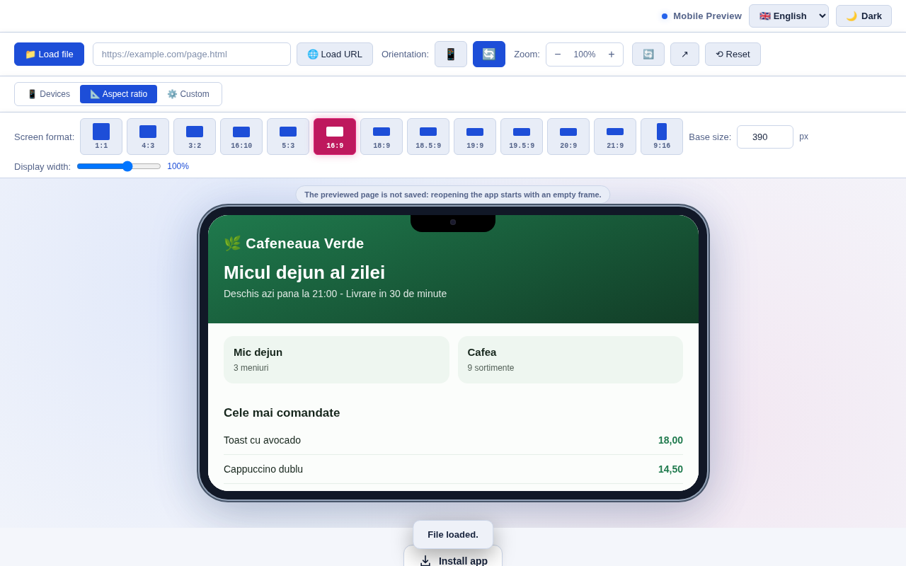
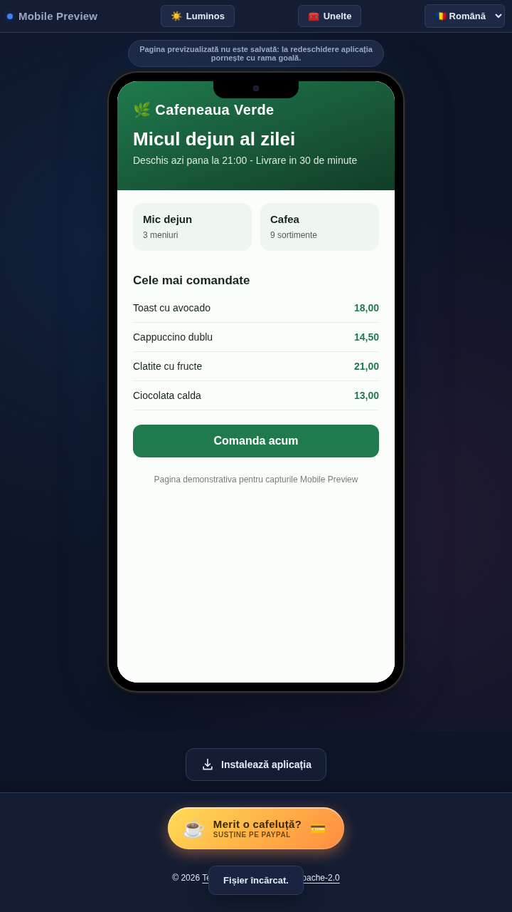

<div align="center">

# 📱 Mobile Preview

### See how any page looks on iPhone, iPad, Android & desktop - in seconds

A zero-dependency, single-file web app that renders any HTML file or URL inside real device frames.

[](LICENSE)
[](https://paypal.me/TekiDeki)
[](#-changelog)
[](#)
[](#)
[-purple?style=flat-square)](#-supported-languages)
[](#)

### 🚀 **[Try it live →](https://tekideki.github.io/Mobile-Preview/)**




</div>

---

## 🌐 Live Demo

**👉 [https://tekideki.github.io/Mobile-Preview/](https://tekideki.github.io/Mobile-Preview/)**

No installation, no sign-up. Works offline once loaded.

---

## 📖 About

**Mobile Preview** is a browser-based device simulator. Load a local `.html` file or paste any URL, and instantly see it rendered inside accurate frames for **phones, tablets and desktops** - with the real viewport dimensions of each device.

Perfect for:

- 🧑‍💻 **Developers** checking responsive layouts without opening DevTools
- 🎨 **Designers** presenting mockups in realistic device frames
- ✍️ **Bloggers & marketers** grabbing screenshots at exact device sizes
- 🧪 **QA testers** comparing how a page behaves across device widths

Everything runs **100% client-side**. Nothing is uploaded, tracked, or sent anywhere.

---

## ✨ Features

- 📱 **12 real devices** - iPhone SE/12/14 Pro/15 Pro Max, Pixel 7, Galaxy S23, iPad Mini/Air/Pro 11"/12.9", Galaxy Tab S8, Desktop
- 📐 **13 aspect ratios** - 1:1, 4:3, 3:2, 16:10, 5:3, 16:9, 18:9, 18.5:9, 19:9, 19.5:9, 20:9, 21:9, 9:16 (Stories/Reels)
- ⚙️ **Custom mode** - any width × height from 100 to 4000 px, with phone / tablet / no-frame rendering and scale control
- 📁 **Load local HTML files** - pick a file or **drag and drop it anywhere** on the preview area
- 🔗 **Load any URL** - paste a link, or just a host name (`example.com` becomes `https://example.com/`); only `http` and `https` are accepted
- 🔄 **Orientation toggle** - portrait ↔ landscape; the frame always follows the orientation you picked, whichever ratio is selected
- 🔍 **Zoom control** - 25% to 200%, plus auto-fit so the frame always fits the viewport
- 🧰 **Collapsible tools on phones** - the toolbar folds away so the frame gets the room; one tap brings it back
- ⏱️ **Number fields stay honest** - values outside their range are clamped and the app says so instead of silently resizing the frame
- 💾 **Every setting resets in one tap** - including panel inputs, with a confirmation toast
- 🌍 **4 languages** - Română, English, Srpski (latinica), Српски (ћирилица); every tooltip and accessible name follows the language
- 🌗 **Dark & light theme** - follows your system, remembers your choice; URL override with `?theme=light`, applied before the first paint (no white flash)
- 🔗 **Shareable state via URL** - `?lang=en`, `?theme=dark`, `?mode=ratio`, `?focus=url`
- 📦 **Installable PWA** - four app shortcuts (URL, Devices, Ratios, Custom), offline shell, and an in-app notice when a new version is cached
- 🪶 **Zero dependencies** - one HTML file, no frameworks, no build step, no CDN, no analytics
- 🔍 **SEO-ready** - JSON-LD (WebApplication with feature list), Open Graph, Twitter cards with alt text, canonical, `hreflang` alternates, sitemap
- ♿ **Accessible** - real `main`/`header`/`footer` landmarks, labelled inputs, `aria-pressed` toggles, keyboard-navigable tab list (arrows/Home/End), live regions for results and toasts, WCAG AA contrast in both themes, `prefers-reduced-motion`
- 🛡️ **Previews are properly isolated** - see below

---

## 🛡️ How Previews Are Isolated

The frame is the core of this tool, so the sandbox matters:

| Content | Sandbox | Why |
|---|---|---|
| Local files and anything you type | `allow-scripts allow-forms allow-popups allow-modals` | The page has **no `allow-same-origin`**: it runs in an opaque origin, cannot read `parent.document`, cannot touch this app's `localStorage`, cannot rewrite its title, and cannot open a tab back into it |
| Remote sites (`https://…`) | the same, plus `allow-same-origin` | so the page keeps its own cookies and storage and renders realistically - it is still a separate origin from this app |

Both local files and URLs are loaded through `iframe.srcdoc` / `iframe.src`, never through `document.write`, so no previewed code ever executes in this app's own document.

Some sites still refuse to load in a frame (they send `X-Frame-Options` or a CSP `frame-ancestors`). The app says so in the empty state and suggests a local file - that is a browser decision, not a bug.

---

## 🚀 Quick Start

### Option 1 - Use the Live Demo (Simplest)

**👉 [https://tekideki.github.io/Mobile-Preview/](https://tekideki.github.io/Mobile-Preview/)**

### Option 2 - Run Locally

```bash
git clone https://github.com/TekiDeki/Mobile-Preview.git
cd Mobile-Preview

# any static server works
python -m http.server 8000
```

Then open **http://localhost:8000**

> 💡 For PWA features (install prompt, offline mode) serve over **HTTPS** or `localhost`.

### Option 3 - Fork & Deploy to Your Own GitHub Pages

1. **Fork** this repository
2. **Settings → Pages**
3. Source: `Deploy from a branch` → Branch: `main` → Folder: `/ (root)`
4. Save → live at `https://YOUR-USERNAME.github.io/Mobile-Preview/`

---

## 📱 Install as an App (PWA)

| Platform | Steps |
|---|---|
| **Android** (Chrome) | ⋮ menu → **Install app** |
| **iPhone / iPad** (Safari) | Share button → **Add to Home Screen** |
| **Desktop** (Chrome / Edge) | Click the **install icon** (⊕) in the address bar |

Once installed it launches full-screen and works without a connection. Four shortcuts are available from a long press on the icon: **URL**, **Devices**, **Ratios**, **Custom**.

---

## 🎮 Usage

1. **Load content** - click **📁 Load file** to pick a local `.html`, drop a file onto the preview area, or paste a URL and hit **🌐 Load URL**
2. **Pick a mode**:
   - **📱 Devices** - choose one of 12 real device presets
   - **📐 Aspect ratio** - pick a ratio, then set the base size and display scale
   - **⚙️ Custom** - enter any width × height, choose frame type and scale
3. **Fine-tune** - toggle orientation, adjust zoom, reload, or open the preview in a new tab
4. **Reset** - returns every control to its default (iPhone 12, portrait, 100%, 390 px base size)

### Keyboard

| Action | How |
|---|---|
| Move between mode tabs | `Tab` to the tab list, then `←` / `→` (or `Home` / `End`) |
| Activate a device, ratio or button | `Tab` to it and press `Enter` / `Space` |
| Load a URL | Focus the URL field and press `Enter` |

---

## 🌍 Supported Languages

| Code | Language | Default |
|------|----------|:-------:|
| `ro` | Română | ✅ (fallback) |
| `en` | English | - (auto-detected from browser) |
| `sr-Latn` | Srpski (latinica) | - |
| `sr-Cyrl` | Српски (ћирилица) | - |

Language priority: **URL parameter** (`?lang=…`) → saved choice → browser language → Romanian.

---

## 🛠️ Tech Stack

- **HTML5** - one file, semantic markup with landmarks
- **CSS3** - custom properties for theming (dark + light token sets), flex layout
- **Vanilla JavaScript** - no frameworks, no bundler, no build step
- **Service Worker** - cache-first shell, never intercepts your preview URLs, posts a message when a new version replaces the old cache
- **Web App Manifest** - installable, standalone, icons, screenshots and four shortcuts
- **JSON-LD** - structured data (`WebApplication` with `featureList`)

No external CDNs. No analytics. No fonts to download. No tracking.

---

## 📁 Project Structure

```
Mobile-Preview/
├── index.html              # Standalone app (HTML + CSS + JS)
├── manifest.json           # PWA manifest (icons, screenshots, shortcuts)
├── sw.js                   # Service worker (offline shell)
├── icon-192.png            # App icon
├── icon-512.png            # App icon (large)
├── icon-maskable-512.png   # Maskable icon (Android)
├── apple-touch-icon.png    # iOS home screen icon
├── favicon.ico
├── og-image.png            # Social share image (1200x630)
├── screenshot-narrow.png   # Phone screenshot (manifest + README)
├── screenshot-wide.png     # Desktop screenshot (manifest + README)
├── robots.txt
├── sitemap.xml             # with hreflang alternates
├── LICENSE                 # Apache License 2.0
├── NOTICE
└── README.md
```

---

## 🔒 Privacy

- No backend, no accounts, no cookies, no analytics
- No preview content is uploaded, cached or stored: the app reads your file locally and hands it to the frame. Reopening the app always starts with an empty frame, and the interface says so
- Previewed URLs are loaded directly by your browser into a sandboxed iframe - the app never sees them
- Language, theme and tools-panel preferences are stored in `localStorage` only, and the app keeps working when storage is blocked (private mode)

---

## 🧪 Tested

- Device, ratio, custom and zoom geometry verified against the real pixel sizes
- Sandbox escape attempts (reading the parent document, the app's storage, the frame element, rewriting its title) all blocked
- URL handling: `javascript:`, `data:` and `file:` inputs rejected
- 4 languages × dark/light, offline reload, blocked storage, drag and drop, manifest and asset checks
- Automated accessibility scan (axe-core) with no violations in either theme

---

## 📄 License

Distributed under the **Apache License 2.0**. See [LICENSE](LICENSE) and [NOTICE](NOTICE) for details.

---

## 📜 Changelog

### 2.0 - 2026-10-15

- **Security:** local files are rendered without `allow-same-origin`, so a previewed file can no longer read this app's DOM, its `localStorage` or its title; local files are delivered through `srcdoc` instead of a same-origin `blob:` URL.
- **Security:** URL input accepts only real `http`/`https` addresses - `javascript:`, `data:` and `file:` are rejected.
- **Fixed:** aspect-ratio mode ignored the chosen orientation for wide ratios (16:9 portrait built a landscape frame); orientation now drives the frame.
- **Fixed:** saved light theme flashed dark on load; the theme is applied before the first paint.
- **Fixed:** `localStorage` was used unguarded; it now has a safe wrapper with an in-memory fallback for private mode.
- **Fixed:** number fields accepted values far outside their declared range (9999 px base size, 99999 px width) and silently shrank the frame; values are clamped and the change is reported.
- **Fixed:** the empty frame was rendered on top of the empty state before anything was loaded.
- **Fixed:** the stale requirement to press `?` in a shared link (nothing handled it) - the hint now describes what the app really supports.
- **Fixed:** `reset` left the panel inputs and the ratio selection untouched and gave no feedback.
- **New:** drag and drop of `.html` files onto the preview area, with a visible drop hint and a refusal message for other file types.
- **New:** collapsible tools panel on phones, so the device frame gets the room.
- **New:** a notice appears when the service worker caches a new version, with a reload button.
- **New:** open in a new tab now works for local files too (temporary object URL), and the tab never gets a handle on this window.
- **Improved:** real tab list for the three modes (arrows, Home/End, `aria-selected`), `aria-pressed` on toggles, labelled inputs, `main`/`header`/`footer` landmarks, live regions for zoom, toasts and the update bar, every tooltip and accessible name translated in all four languages.
- **Improved:** WCAG AA contrast - filled buttons and active tabs use a darker accent for white text; hint and label colours raised in both themes; focus rings 3 px.
- **Improved:** `?mode=`, `?focus=` and `?theme=` parameters, manifest screenshots and four app shortcuts, JSON-LD feature list, `og:image:alt`, `color-scheme` meta, `<noscript>` note, 8 MB file size guard, unsaved-preview notice.
- **Improved:** offline cache bumped to `mobile-preview-v6` (now includes the screenshots and the social image).

### 1.x

- 1.0 - first public release: 12 device presets, 13 aspect ratios, custom sizes, local files and URLs, four languages, dark/light themes, installable PWA with offline shell.

---

<div align="center">

**Built with ❤️ and vanilla JavaScript**

[⬆ Back to Top](#-mobile-preview)

</div>

## Install app

Use the **Install app** button near the footer. On supported browsers it opens the native installation prompt when available. Otherwise it shows localized instructions for Safari on iPhone/iPad, Android, and desktop browsers. Installation is controlled by the browser; no installation is claimed without its confirmation. The button is hidden in a standalone/minimal-ui app window and after an `appinstalled` event in the current session. A normal browser tab cannot always detect a previous installation.

Installation needs HTTPS or trustworthy localhost. The controls add no dependencies, tracking, network calls or storage keys; existing application data is not modified. On an existing cached version, revisit online and refresh after the service worker has updated to see the button. No automatic reload is forced.
